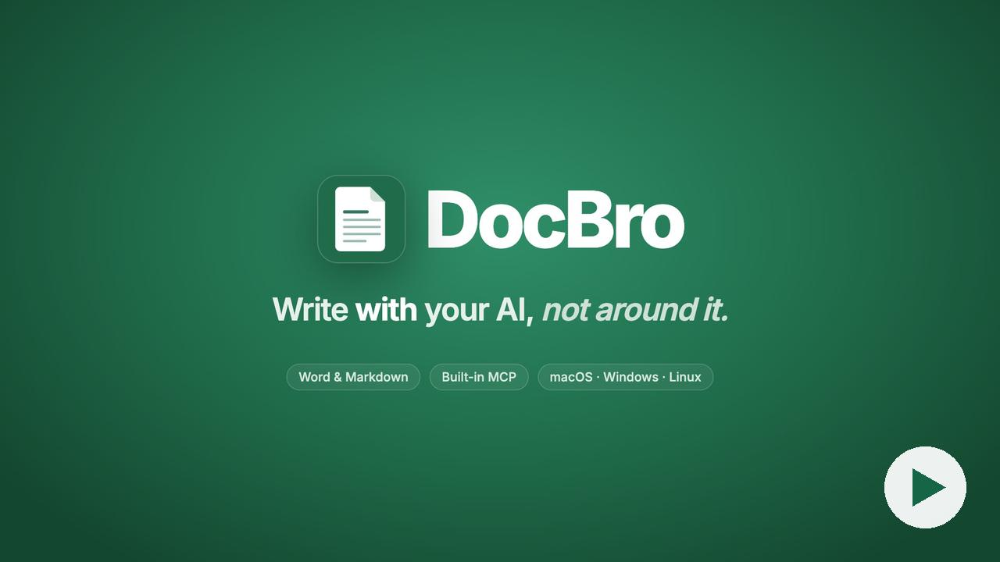
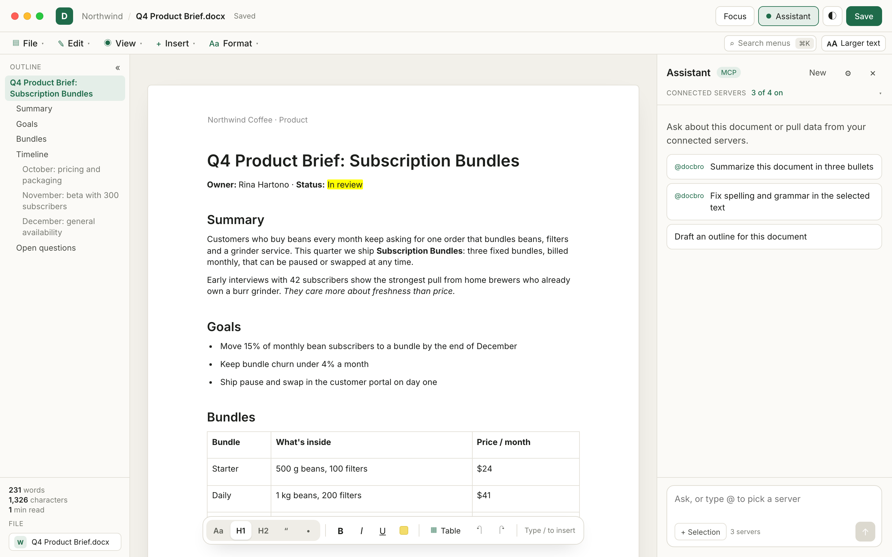
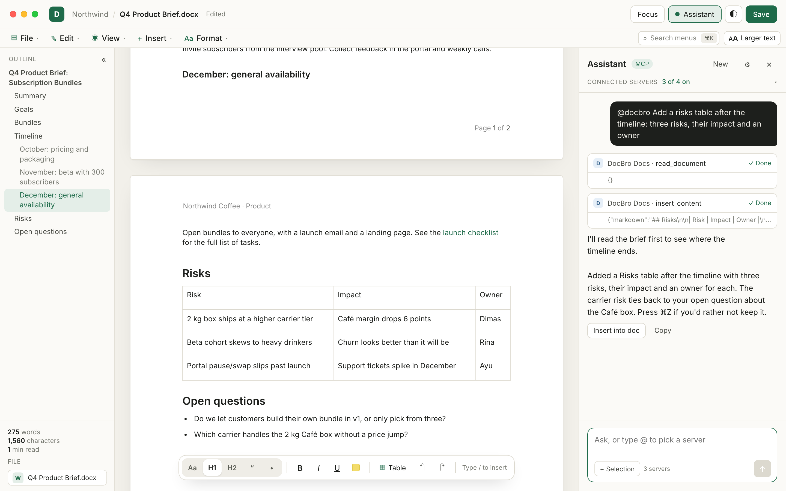
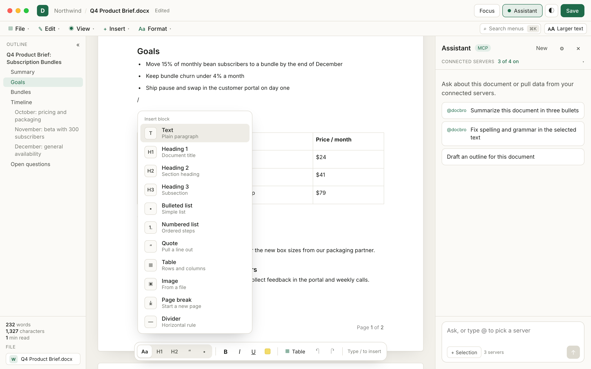
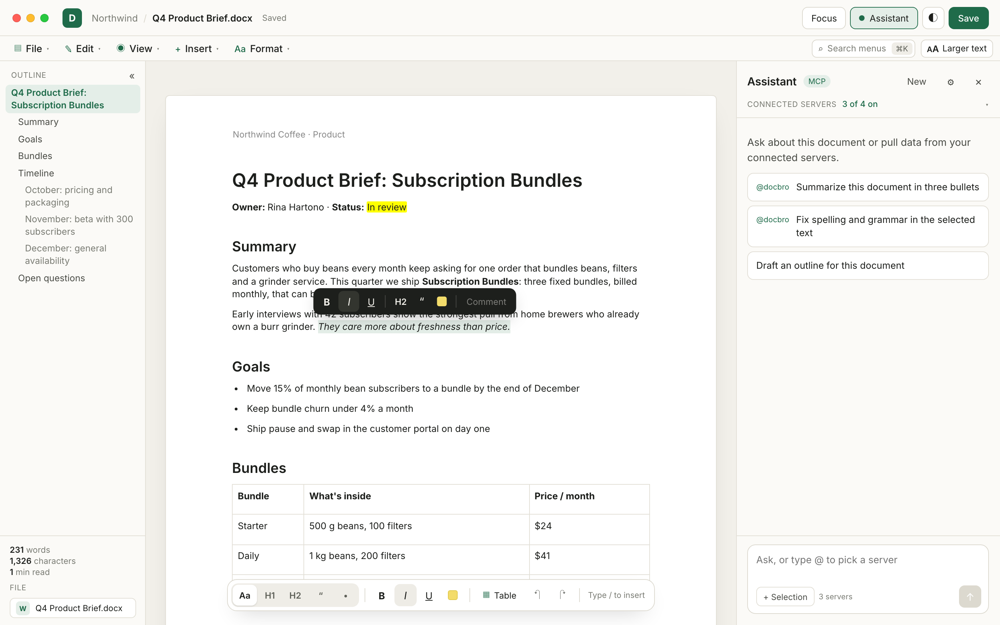
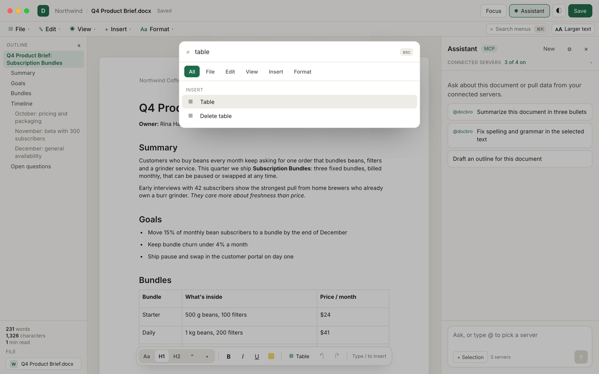
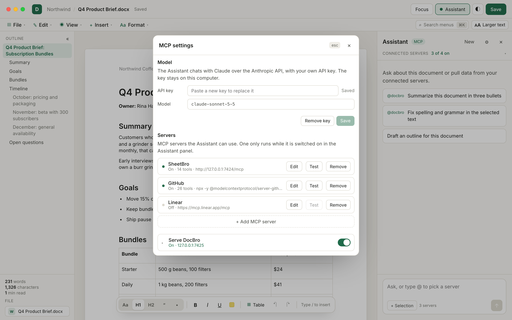
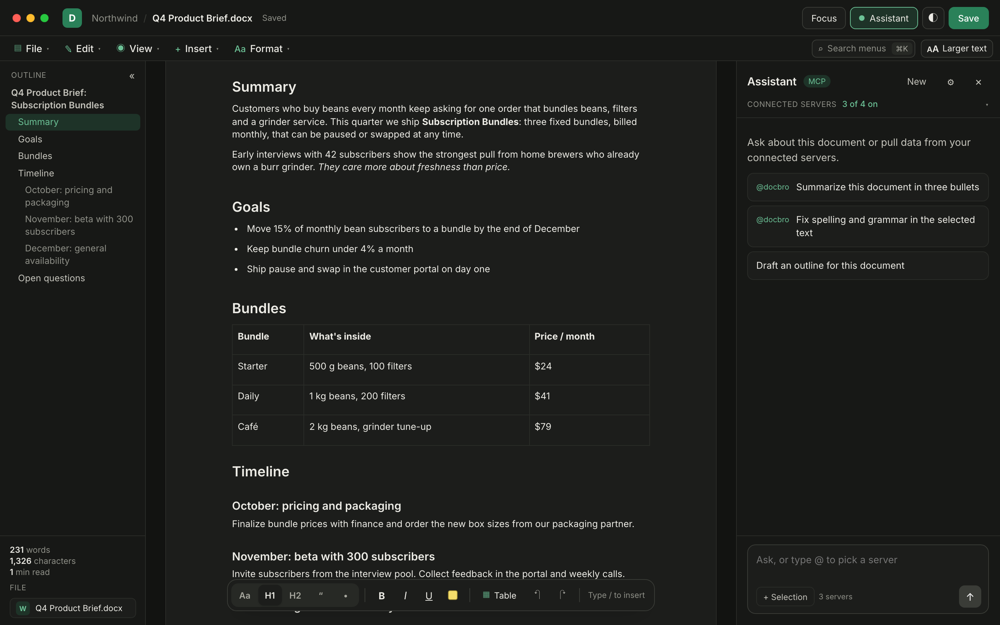

<p align="center">
  
</p>

<h1 align="center">DocBro</h1>

<p align="center">
  A fast, native word processor for Word and Markdown files, with your AI built in.<br>
  macOS · Windows · Linux
</p>

<p align="center">
  
</p>

DocBro opens `.docx` and `.md` files and edits them in a clean, paged editor. It also runs an MCP server, so Claude, Cursor, Codex and other AI tools can read and edit the document you have open. Every edit shows up on the page as it happens, and **each AI edit is a single undo step**, so ⌘Z takes back exactly what the AI did, never your own typing. When a document is ready to share, **File ▸ Upload to Google Docs** puts it in your Google Drive as a Google Doc.

<p align="center">
  <a href="docs/media/docbro-teaser.mp4">
    
  </a>
  <br>
  <sub><a href="docs/media/docbro-teaser.mp4">Watch the 43-second teaser</a></sub>
</p>

## Contents

- [Download](#download)
  - [One-line install](#one-line-install)
  - [Download the installer](#download-the-installer)
- [Features](#features)
  - [What DocBro keeps from Word files](#what-docbro-keeps-from-word-files)
- [Screenshots](#screenshots)
- [Connect your AI tools](#connect-your-ai-tools)
  - [Available tools](#available-tools)
- [Google Docs](#google-docs)
- [The Assistant](#the-assistant)
  - [Chatting](#chatting)
  - [Continue a Claude Code session](#continue-a-claude-code-session)
  - [Adding MCP servers](#adding-mcp-servers)
  - [What leaves your computer](#what-leaves-your-computer)
- [Security](#security)
- [Build from source](#build-from-source)
  - [macOS](#macos)
  - [Windows](#windows)
  - [Linux](#linux)
  - [Building with GitHub Actions](#building-with-github-actions)
  - [Build it with an AI agent (no coding needed)](#build-it-with-an-ai-agent-no-coding-needed)
- [How it works](#how-it-works)
- [Changelog](#changelog)
- [Contributing](#contributing)
- [License](#license)

## Download

### One-line install

macOS and Linux, in Terminal:

```sh
curl -fsSL https://raw.githubusercontent.com/jetorbitdev/docbro/main/install.sh | bash
```

Windows, in PowerShell:

```powershell
irm https://raw.githubusercontent.com/jetorbitdev/docbro/main/install.ps1 | iex
```

The installer downloads the latest release and checks it against the SHA-256 checksum GitHub records for the file. Then:

- **macOS:** it copies `DocBro.app` from the `.dmg` into `/Applications` and opens it. There's no Gatekeeper prompt, because files downloaded with `curl` aren't quarantined. It may ask for your password if `/Applications` needs admin rights. To install somewhere else, put `INSTALL_DIR=~/Applications` before `bash`.
- **Linux:** it installs the `.deb` with apt on Debian and Ubuntu, or the `.rpm` with dnf or zypper on Fedora, the RHEL family and openSUSE, and asks for your password. On other distributions it puts the `.AppImage` in `~/.local/bin/docbro` and adds a menu entry.
- **Windows:** it runs the setup silently for your user account, so there's no administrator prompt and no SmartScreen warning.

### Download the installer

Or get the installer for your OS from the [latest release](https://github.com/jetorbitdev/docbro/releases/latest):

| OS | File |
|---|---|
| macOS 11 or later | `.dmg` |
| Windows 10 or 11 | `.exe` setup or `.msi` |
| Debian, Ubuntu | `.deb`, or the `.AppImage` on any other distribution |
| Fedora, RHEL family 10 or later | `.rpm` (on RHEL, AlmaLinux and Rocky Linux, enable EPEL first) |

DocBro is developed and tested on macOS. The Windows and Linux installers are built by a [GitHub Actions workflow](#building-with-github-actions) and get less testing; on those systems, opening a file by double-clicking it in the file manager isn't handled yet, so use the Open dialog or drag the file onto the window. The Windows installers aren't code-signed, so SmartScreen shows a warning: choose **More info**, then **Run anyway**.

The `.dmg` is built on a Mac and attached to the release by hand. If a release has none yet, [build from source](#build-from-source), or have an AI agent [build it for you](#build-it-with-an-ai-agent-no-coding-needed).

## Features

**Documents**

- Open `.docx` and `.md` files from the Open dialog, by dragging them onto the window, or with Finder's *Open With*. Save as `.docx`, or pick `.md` in *Save as…*
- A Word file keeps its page size, margins, headers, footers and comments. If it holds parts DocBro can't keep yet, such as footnotes or tracked changes, saving over it first names those parts and asks before anything is lost.
- Pages laid out as sheets, with page breaks, headers, footers and page numbers
- Headings, lists, tables, images, links, quotes, dividers, text color, highlight, alignment and comments
- One document per window

**Google Docs**

- Upload the open document to your Google Drive as a Google Doc, saved or not, from File ▸ Upload to Google Docs
- Uploading the same file again updates that Google Doc, so its link and its sharing stay the same
- DocBro reaches only the files it uploaded, nothing else in your Drive. See [Google Docs](#google-docs).

**Editing**

- Slash menu: type `/` to insert a heading, list, table, image, page break and more
- A selection bubble for bold, italic, underline, headings, quotes, highlights and comments
- Command palette (⌘K) that searches every menu command
- Find and replace (⌘F, ⌥⌘F)
- An outline sidebar, plus word count, character count and reading time
- Focus mode, dark mode, larger text, and a serif or sans-serif body font

**AI**

- **Built-in MCP server.** AI clients connect over HTTP on `127.0.0.1`, or over stdio with `--mcp-stdio`, and get 13 document tools: `document_info`, `read_document`, `insert_content`, `replace_blocks`, `delete_blocks`, `find_replace`, `format_text`, `list_comments`, `add_comment`, `undo`, `redo`, `open_document` and `save_document`.
- **Assistant panel.** Chat about the document with Claude or another model. It can use DocBro's document tools and the tools of any MCP server you add, whether HTTP or stdio.
- When another app's AI edits the document, its tool calls show up in the Assistant panel as "External" cards.

### What DocBro keeps from Word files

DocBro is not Word, so it reads a `.docx` into the parts its editor has, and writes those back. This is what survives a round trip.

**Kept**

- **Text.** Paragraphs, headings 1 to 3 (Word's Title style becomes heading 1), block quotes, bulleted and numbered lists with their levels, line breaks, page breaks and dividers.
- **Formatting.** Bold, italic, underline, strikethrough, text color, highlight, links, and the typeface of text that isn't in the body's typeface. Paragraph alignment, spacing and first-line indent.
- **Tables.** Rows, columns, merged cells, column widths, cell fill and the table's indent.
- **Pictures.** PNG, JPEG and GIF pictures in the text. A picture that fills a whole page, such as a cover, gets a sheet of its own.
- **Page.** Letter or A4 paper, the margins, and the file's own type and spacing for the body and the three heading levels, so pages break about where Word's do.
- **Headers and footers.** The default header and footer of the file's last section, including page numbers and fields such as `PAGE` and `NUMPAGES`. One that is a single plain line is edited as text. A richer one, with several paragraphs, pictures or a rule, is shown on the sheet, can be edited there, and is written back as the file had it until you edit it.
- **Comments.** Word comments with their author, date, text and the text they sit on. DocBro writes new ones back as Word comments.

**Reported, then lost when you save over the file**

Before DocBro saves over a `.docx` that has any of these, it names them and asks first. Use *Save as…* to keep the original untouched. The names below are the ones it shows.

- `headers` and `footers`: a first-page or even-page header or footer, and those of any section but the last.
- `comments`: every comment, when the file's comments part can't be read.
- `resolved comments`: comments marked as resolved in Word.
- `comments on no text`: comments that aren't attached to any text.
- `footnotes`: footnotes and endnotes.
- `tracked changes`: DocBro shows the text with every change accepted, and saves it that way.
- `page setup`: landscape pages, paper that isn't Letter or A4, columns and gutters.
- `other content`: text boxes, charts, diagrams, equations, shapes, embedded objects and symbols, the phonetic guide above ruby text, and pictures that are linked from outside the file or are not PNG, JPEG or GIF (a BMP or WebP picture in the body is not shown, because saving can't keep it).

**Not kept, and not reported**

Things the editor or the `.docx` writer has no place for: the size of a single run of text (the size most of the text has is kept), superscript and subscript, and heading levels 4 to 9 (they become body paragraphs).

Saving as `.md` can't keep comments, headers and footers. DocBro says so and asks first. The `save_document` tool refuses a lossy save unless the client passes `accept_loss`.

## Screenshots

| | |
|---|---|
|  |  |
| **Editor.** A Word file opened as laid out, with its header, table and outline | **Assistant.** Claude reads the brief and inserts a table, as one undo step |
|  |  |
| **Slash menu.** Type `/` to insert any block | **Selection bubble.** Format selected text or comment on it |
|  |  |
| **Command palette.** ⌘K searches every menu command | **MCP settings.** Model, your MCP servers, and DocBro's own server |
|  | |
| **Dark mode** | |

## Connect your AI tools

1. Open the Assistant panel (⌥⌘A) and click the gear to open **MCP settings**.
2. Turn on **Serve DocBro**. It listens on `http://127.0.0.1:7425/mcp` and requires a bearer token, which you can regenerate at any time.
3. Copy the ready-made snippet for your client: Claude Code, Claude Desktop, Cursor, VS Code, Windsurf, Gemini CLI, Codex CLI, or "Other". For Claude Code, the snippet looks like this:

   ```bash
   claude mcp add --transport http docbro http://127.0.0.1:7425/mcp --header "Authorization: Bearer <token>"
   ```

   Clients that run stdio servers start the DocBro app with `--mcp-stdio`. It relays to the running app and needs no token.

The server is off by default. It binds to `127.0.0.1` only, and refuses requests that carry an `Origin` header or the wrong `Host`.

There are two ways to connect:

| Transport | Used by | How it works |
|---|---|---|
| Streamable HTTP | Claude Code, Cursor, VS Code, Windsurf, Gemini CLI | `POST http://127.0.0.1:7425/mcp` with an `Authorization: Bearer <token>` header |
| stdio | Claude Desktop, Codex CLI | The client launches the DocBro binary with `--mcp-stdio`. It reads the port and token from DocBro's own settings and relays messages to the running app, so Serve DocBro must be on |

The port is 7425 unless you change it in MCP settings (1024 to 65535). SheetBro uses 7424, so the two apps can run side by side.

### Available tools

| Tool | What it does |
|---|---|
| `document_info` | The open document's name, path, format (`docx` or `md`), unsaved-changes flag, and counts of blocks, words, characters and comments. Also its outline (headings with their block numbers), the typeface and sizes text has when it sets none of its own, the fonts and sizes DocBro offers, and any parts of the file DocBro can't keep. Call it first |
| `read_document` | Reads blocks as Markdown, each marked with its block number. A long document comes in pages, and the end of the text says where to go on |
| `read_fonts` | The typeface and size in points of each block's text. A block that mixes them comes as runs, each with the start of its text |
| `insert_content` | Inserts Markdown as new blocks before or after a block, or at the end |
| `replace_blocks` | Replaces a range of blocks with Markdown. This is how to change something inside a list or a table |
| `delete_blocks` | Deletes a range of blocks |
| `find_replace` | Replaces every occurrence of a piece of text, in the whole document or in a range of blocks. Case sensitive unless told otherwise, and it reports how many it replaced |
| `format_text` | Bold, italic, underline, strikethrough, text color, highlight, typeface, size in points and links, on whole blocks or only on the occurrences of some text. Also paragraph style (body, heading 1 to 3, quote), alignment, and turning blocks into a list or back |
| `list_comments` | The document's comments, each with its author, date, text and the text it is on |
| `add_comment` | Adds a comment from "AI" on a block, or on some text in it. It shows beside the page, and you can resolve it |
| `undo` / `redo` | Undoes or redoes the last change, whether yours or an AI's |
| `open_document` | Opens a `.docx` or `.md` file. It refuses to discard unsaved changes unless asked to |
| `save_document` | Saves the file, or saves to a new path. It won't replace another file, or save over a file that would lose parts DocBro can't keep, unless asked to |

Notes for people writing prompts or building clients:

- **Blocks.** The document is a list of top-level blocks (paragraphs, headings, lists, quotes, tables, images and dividers), numbered from 1. A whole list or table is one block. `insert_content` and `replace_blocks` take Markdown and work on whole blocks, so they can't go inside a list or a table cell.
- **One undo step per call.** Each edit tool call is a single step in the undo history, closed off from your own typing before and after it. ⌘Z takes back exactly that call.
- **Which window.** A call from an AI client runs in the window you used last. If it sends an argument a tool doesn't take, the call is refused, not ignored.
- **Unsaved work.** Edits live in the open window until `save_document` runs. `document_info` carries the unsaved-changes flag, so a client can remind you to save.
- **Fonts and sizes.** Markdown carries neither, so `read_document` doesn't show them and new blocks start in the page's own. `read_fonts` tells what the text is set in, and `format_text` sets `font` (a name such as `Georgia`) and `size` (1 to 400 points, to the half point). `null` gives the text the page's own again, and changing one of color, font or size leaves the other two alone.
- **Colors** are `#rrggbb`. A link must be `http`, `https` or `mailto`.
- **Pictures.** The Markdown tools can't embed a picture. An image link such as `` is kept in the document as a link and drawn as its alt text and address. DocBro never loads it.

## Google Docs

**File ▸ Upload to Google Docs** puts the open document in your Google Drive as a Google Doc, as it is in the window, saved or not. A `.md` file goes up the same way as a `.docx`. Uploading the same file again replaces the Google Doc's content, so its link and its sharing stay the same. If that Google Doc was deleted or put in the trash, a new one is made. A document that has no file yet makes a new Google Doc each time. The upload only goes one way: changes made in Google Docs don't come back into DocBro.

DocBro asks Google only for access to the files it uploads itself (the `drive.file` scope). It can't see or change anything else in your Drive.

To set it up, open **MCP settings** and find **Google Docs**:

1. If your copy of DocBro doesn't come with an OAuth client, make one. In [Google Cloud Console](https://console.cloud.google.com), create a project, turn on the **Google Drive API**, set up the OAuth consent screen (add yourself as a test user while the app is in testing), and create an **OAuth client ID** of type **Desktop app**. Paste its client ID and client secret into DocBro and press **Save**.
2. Press **Connect**. Google's sign-in page opens in your browser. Once you agree, the browser sends the answer back to DocBro, and the settings show the account you connected.

**Disconnect** forgets the account on this computer and asks Google to end DocBro's access.

## The Assistant

The Assistant answers through one of three engines. Pick one in **MCP settings**, under **Model**. Saving is what switches to it.

- **Claude Code.** If the `claude` CLI is installed and you haven't saved an API key, the Assistant runs on Claude Code and uses your Claude subscription. The model is a Claude Code alias or name, `sonnet` by default.
- **Anthropic API.** Paste an API key in MCP settings. The default model is `claude-sonnet-5-5`.
- **Other provider.** Any service with an OpenAI-compatible API. Pick OpenAI, OpenRouter, Google Gemini, Groq, DeepSeek, Mistral, Ollama, LM Studio or Custom, and the preset fills in the base URL, which you can still edit. Type a model name, or click **Load models** to pick one from the provider's list. Ollama and LM Studio need no key. The model has to support tool calling. If it doesn't, DocBro says so.

Settings live in your OS config folder under `com.jetorbit.docbro/`, readable only by you (file mode `0600` on macOS and Linux). The API key never reaches the window. The app shows only its last four characters, and the key never appears in logs or error messages.

### Chatting

Ask a question, or start from one of the suggestions. **+ Selection** sends the text you selected with your message. **Stop** ends an answer and **New** starts a fresh chat. When an answer is something you want in the document, **Insert into doc** adds it as new blocks after the block you're in, as one undo step. **Copy** copies it.

The Assistant's tool calls show as cards in the chat. Each document edit is one undo step, like an AI client's. It stops after 12 rounds of tool calls for one message, and says so; send another message to let it go on.

### Continue a Claude Code session

With the Claude Code engine, **Continue a Claude Code session…** (in the empty chat) brings in a conversation you started elsewhere. Your next message goes on in a copy of it, so the original stays as it was. Its earlier messages aren't shown in the panel.

- **On this Mac.** Pick one of up to 50 recent Claude Code sessions, whether you started them in a terminal or an editor. DocBro only reads the session files in `~/.claude/projects` to list them, and never changes them.
- **From the web.** Paste the link or id of a session from Claude Code on the web (claude.ai/code). DocBro doesn't bring it over itself: it shows the command `claude --teleport <session id>` to run once in Terminal, in the repository the web session worked on. The session then appears under **On this Mac**.

### Adding MCP servers

The Assistant can use other MCP servers, so one chat can read your document and, say, query a spreadsheet. In MCP settings click **+ Add MCP server** (the Assistant panel has the same button) and choose:

- **HTTP**: a URL and optional headers, such as `Authorization`.
- **Command**: a program that runs on your computer and talks over stdio, with its arguments and environment variables. The form shows the exact command line and waits for your confirm before it runs anything.

**Test** connects and lists the server's tools. **SheetBro preset** fills in a server for [SheetBro](https://github.com/jetorbitdev/sheetbro), the spreadsheet app this one is a sibling of: `http://127.0.0.1:7424/mcp` with an `Authorization` header, for which you paste the token from SheetBro's AI tools panel.

Each server has a switch in the Assistant panel, next to DocBro's own document tools. The Assistant never starts or contacts a server that is off. Start a message with `@` and a server's id to use only that server, along with DocBro's document tools; `@docbro` uses the document tools alone.

### What leaves your computer

DocBro itself sends nothing anywhere: no telemetry and no update check. It also never loads a picture from the web. A picture that is linked by address, in a Markdown file or in text an AI inserts, shows as its alt text and its address until you replace it, and a Markdown save writes the same link back. Only pictures inside the document (or made by the page) are drawn.

Uploading to Google Docs connects to Google, and only when you connect an account, upload, or disconnect. An upload sends the whole document, as a Word file, to Google Drive.

Apart from that, only the Assistant makes outgoing connections, and only when:

- you send a message;
- you load a provider's models;
- you switch on or test an HTTP server you added, or save one that is already switched on. Saving a Command server that is already on starts it the same way.

Requests to a provider that isn't on this computer go through your system proxy (`HTTP_PROXY` and the like), and requests to OpenRouter carry an `X-Title: DocBro` header.

A message carries your text, the text you added with **+ Selection**, the document's name and its outline (the headings, while DocBro's document tools are on), and the names and descriptions of the tools on offer. As the model uses tools, their results go back to it, including any document text it reads and anything your MCP servers answer. Where all of that goes depends on the engine:

- **Claude Code.** DocBro runs your `claude` and gives it the message and your MCP servers that are on. Claude Code sends it to Anthropic under your Claude subscription and its own settings, and keeps the conversation as a normal Claude Code session on your computer. DocBro never reads Claude Code's sign-in, and passes it no API key.
- **Anthropic API.** It goes to the Anthropic API, with your key.
- **Other provider.** It goes to the base URL you set, with that provider's key if it has one. For Ollama, LM Studio and any other address on this computer (`localhost`, `127.0.0.1` or `::1`), DocBro sends nothing off the computer.

With every engine, the arguments the model picks for a tool of one of your MCP servers go to that server, and its answer goes back to the model.

## Security

- **Settings files.** They live in your OS config folder under `com.jetorbit.docbro/`: `~/Library/Application Support` on macOS, `%APPDATA%` on Windows and `~/.config` on Linux.

  | File | Holds |
  |---|---|
  | `mcp.json` | Whether Serve DocBro is on, its port, and its access token |
  | `assistant.json` | The engine, the models, your Anthropic API key, and the other provider's base URL and key |
  | `servers.json` | The MCP servers you added, with their header and environment values |
  | `google.json` | Your own Google OAuth client and its secret, the connected Google account and its refresh token, and which Google Doc each file was uploaded to |

  On macOS and Linux these files are readable only by you (mode `0600`), and DocBro makes `assistant.json`, `servers.json` and `google.json` private again if something loosened them. Keys, tokens and header values are stored in them as plain text: there is no OS keychain in this version. On Windows the files sit in your AppData folder and DocBro doesn't change their permissions.
- **The MCP server.** Serve DocBro is off by default. When it is on, it listens on `127.0.0.1` only and answers `POST /mcp` only. Every request needs the bearer token, and a request with an `Origin` header, or with a `Host` that isn't the server's own address, is refused, which keeps web pages from driving the document. A request body over 8 MiB is refused. Regenerating the token in MCP settings locks out every client that still has the old one. Treat the token like a password: a client that has it can read and edit the open document, and open and save `.docx` and `.md` files your user account can reach.
- **API keys.** The Anthropic key and the other provider's key stay in the Rust core. The window only learns the last four characters of a key, and a key is never logged or put in an error message, even when a service repeats it back. (The MCP access token is different: MCP settings shows it, so you can copy it into your client.)
- **A saved key only goes to the server it was saved for.** The Anthropic key goes to `api.anthropic.com` and nowhere else. The other provider's key goes only to the origin (scheme, host and port) of the base URL it was saved with: change the host and DocBro drops the saved key, and you enter it again. The same goes for the header and environment values of an MCP server: point its URL at another host, or change its command, and the saved values aren't carried over. Redirects aren't followed, so a key can't be passed on to another host. A provider's base URL can be plain `http://` only for this computer, but an MCP server's URL can be any `http://` or `https://` address, so use `https://` for anything that isn't on this computer.
- **Command servers.** Adding or testing an MCP server of type Command shows the exact command line and waits for your confirm. It then runs only while the server is switched on, with your user account's permissions, so only add programs you trust.
- **Claude Code.** DocBro starts `claude` with its built-in tools off (no Bash, Edit or Read), without your Claude Code hooks, skills and settings, and with only the MCP servers DocBro gives it. Your message, and the text you add with **+ Selection**, go on its standard input. The document's name and its outline headings are part of the instructions DocBro gives it on its command line, where another process of the same user can read them (with `ps`, for example). The MCP servers' header and environment values go in a temporary file that only you can read (on macOS and Linux), which is deleted when the answer ends. DocBro's document tools reach `claude` through a listener on `127.0.0.1`, on a port the system picks, that exists only while a Claude Code answer is running. It takes a token made for that run and never saved, and it works whether or not Serve DocBro is on. Your own access token gets nothing there. On macOS and Linux, when DocBro quits it tells any `claude` it started to stop.
- **Google Docs.** Signing in happens in your browser, on Google's own page, so DocBro never sees your Google password. The browser hands the answer back to a listener on `127.0.0.1` that exists only while a sign-in waits, and the sign-in uses PKCE, so another program that catches the answer can't use it. The refresh token, the access token and the OAuth client's secret stay in the Rust core: the window only learns the secret's last four characters and never a token. They go only to Google's sign-in and Drive addresses, redirects aren't followed, and none of them is put in an error message. A token works only with the OAuth client it was given to, so saving another client disconnects the account.
- **Undo.** Every AI edit, from an external client or from the Assistant, goes into the normal undo history as one step.

## Build from source

You need [Rust](https://rustup.rs) (stable), Node.js 20.19+ or 22.12+, [pnpm](https://pnpm.io), and the [Tauri prerequisites](https://tauri.app/start/prerequisites/) for your OS.

```bash
pnpm install
pnpm tauri dev      # run the app with hot reload
pnpm tauri build    # build the .app and .dmg on macOS (Windows and Linux: see below)
```

To build a copy that comes with a Google OAuth client, so its users only have to press Connect, set `DOCBRO_GOOGLE_CLIENT_ID` and `DOCBRO_GOOGLE_CLIENT_SECRET` in the environment of `pnpm tauri build`. A client entered in MCP settings takes its place.

To run the tests:

```bash
pnpm test                                       # TypeScript (Vitest)
cargo test --manifest-path src-tauri/Cargo.toml # Rust core
```

`tauri.conf.json` only lists the macOS bundle formats, so on Windows and Linux pass `--bundles` to choose an installer format. All bundles are written to `src-tauri/target/release/bundle/`. The OS-specific requirements are below.

### macOS

- macOS 11 or later
- Xcode Command Line Tools (`xcode-select --install`)

```bash
pnpm tauri build    # DocBro.app in bundle/macos, a .dmg in bundle/dmg
```

The build isn't code-signed or notarized.

### Windows

- Windows 10 or 11 (64-bit)
- [Microsoft C++ Build Tools](https://visualstudio.microsoft.com/visual-cpp-build-tools/) with the **Desktop development with C++** workload
- [WebView2](https://developer.microsoft.com/microsoft-edge/webview2/). It is already installed on Windows 11 and up-to-date Windows 10.
- The MSVC Rust toolchain: `rustup default stable-msvc`

In PowerShell:

```powershell
pnpm tauri build --bundles nsis   # setup .exe in bundle\nsis
pnpm tauri build --bundles msi    # .msi in bundle\msi (downloads the WiX toolset on first run)
```

The plain executable is at `src-tauri\target\release\docbro.exe`.

### Linux

Install the WebKitGTK and build dependencies for your distribution.

Debian / Ubuntu (22.04 or later):

```bash
sudo apt update
sudo apt install libwebkit2gtk-4.1-dev build-essential curl wget file \
  libxdo-dev libssl-dev libayatana-appindicator3-dev librsvg2-dev
```

Fedora:

```bash
sudo dnf install webkit2gtk4.1-devel openssl-devel curl wget file \
  libappindicator-gtk3-devel librsvg2-devel libxdo-devel
sudo dnf group install "c-development"
```

RHEL family (RHEL, AlmaLinux, Rocky Linux 10 or later). WebKitGTK 4.1 comes from EPEL. Version 9 only ships WebKitGTK 4.0, which Tauri 2 doesn't support, so DocBro can't be built or run there.

```bash
sudo dnf install epel-release dnf-plugins-core   # on RHEL itself, install EPEL from the Fedora docs
sudo dnf config-manager --set-enabled crb
sudo dnf install gcc gcc-c++ make curl file openssl-devel \
  webkit2gtk4.1-devel librsvg2-devel libappindicator-gtk3-devel
```

Arch:

```bash
sudo pacman -S --needed webkit2gtk-4.1 base-devel curl wget file openssl \
  appmenu-gtk-module libappindicator-gtk3 librsvg xdotool
```

Then build:

```bash
pnpm tauri build --bundles deb,appimage   # .deb in bundle/deb, .AppImage in bundle/appimage
pnpm tauri build --bundles rpm            # .rpm in bundle/rpm (Fedora, RHEL family)
```

The plain executable is at `src-tauri/target/release/docbro`.

### Building with GitHub Actions

The [Release (Windows & Linux)](.github/workflows/release.yml) workflow builds the installers that aren't built locally:

| Runner | Installers |
|---|---|
| `windows-latest` | `.exe` (NSIS) and `.msi` |
| `ubuntu-22.04` | `.deb` and `.AppImage` |
| AlmaLinux 10 container | `.rpm` for Fedora and the RHEL family |

Run it from the **Actions** tab. With **release** off, the installers are uploaded as workflow artifacts, which is useful for checking that a change still builds. With **release** on, they are attached to a draft GitHub release for the version in `src-tauri/tauri.conf.json`. The release title and notes come from that version's entry in the [changelog](#changelog), so add the entry first. Build the macOS `.dmg` on a Mac with `pnpm tauri build`, upload it to the same draft, then publish it. Nothing is public until you publish the draft.

The Windows installers aren't code-signed, so Windows SmartScreen warns before running them.

### Build it with an AI agent (no coding needed)

You don't need to know the terminal to build DocBro. An AI coding agent can do every step for you, and these prompts tell it what to do and when to ask you first.

1. Install an AI coding agent if you don't have one: [Claude Code](https://claude.com/claude-code), [Cursor](https://cursor.com) or [Codex](https://openai.com/codex).
2. Make a new, empty folder, for example `DocBro` in your Documents folder, and open the agent in it.
3. Copy the prompt for your computer below, paste it into the agent and press Enter.
4. Say yes when the agent asks to install something. On Mac and Linux it may ask for your computer password, and on Windows it may show an administrator prompt. The first build takes 10 to 30 minutes, most of it downloading tools.

You can write back to the agent in any language. If something goes wrong, paste the error into the chat and ask it to fix it.

**macOS**

```text
Please build the DocBro app for me on this Mac. I'm not a programmer, so do every step
yourself and explain what you're doing in plain words.

1. If this folder doesn't have DocBro's code yet, download it with
   `git clone https://github.com/jetorbitdev/docbro.git` and work inside the docbro folder.
   Then read the "Build from source" and "macOS" parts of README.md.
2. Check what's installed: Xcode Command Line Tools, Rust (stable, from rustup.rs),
   Node.js 20.19+ or 22.12+, and pnpm. Install whatever is missing. Tell me before anything
   asks for my password or opens an installer window, and wait for me to finish it.
3. Run `pnpm install`, then `pnpm tauri build`.
4. If the build fails, read the error, fix the cause and build again. Don't change the
   app's code unless the error is in it, and tell me what you changed.
5. When it's done, copy DocBro.app from src-tauri/target/release/bundle/macos to my
   Applications folder (ask me first if one is already there), and open it.
6. Tell me how to open it next time. The app isn't signed by Apple, so if macOS says it
   can't be opened, explain how to allow it in System Settings > Privacy & Security.
```

**Windows**

```text
Please build the DocBro app for me on this Windows PC. I'm not a programmer, so do every
step yourself and explain what you're doing in plain words. Use PowerShell.

1. If this folder doesn't have DocBro's code yet, download it with
   `git clone https://github.com/jetorbitdev/docbro.git` and work inside the docbro folder
   (install Git with `winget install Git.Git` first if it's missing).
   Then read the "Build from source" and "Windows" parts of README.md.
2. Check what's installed: Microsoft C++ Build Tools with "Desktop development with C++",
   WebView2, Rust with the stable-msvc toolchain, Node.js 20.19+ or 22.12+, and pnpm.
   Install whatever is missing, with winget where you can. Tell me before an administrator
   prompt or installer window appears, and wait for me to finish it. If a new tool isn't
   found after installing it, open a new PowerShell window and carry on.
3. Run `pnpm install`, then `pnpm tauri build --bundles nsis`.
4. If the build fails, read the error, fix the cause and build again. Don't change the
   app's code unless the error is in it, and tell me what you changed.
5. When it's done, run the setup .exe from src-tauri\target\release\bundle\nsis so
   DocBro is installed and shows in the Start menu.
6. Tell me how to open it next time. The installer isn't signed, so if Windows SmartScreen
   warns about it, explain that I can choose "More info", then "Run anyway".
```

**Linux**

```text
Please build the DocBro app for me on this Linux computer. I'm not a programmer, so do
every step yourself and explain what you're doing in plain words.

1. If this folder doesn't have DocBro's code yet, download it with
   `git clone https://github.com/jetorbitdev/docbro.git` and work inside the docbro folder.
   Then read the "Build from source" and "Linux" parts of README.md.
2. Find out which distribution and version I'm running from /etc/os-release. If it's
   RHEL, AlmaLinux or Rocky Linux older than 10, stop and tell me it isn't supported.
3. Install the system packages README.md lists for my distribution. Tell me before you run
   anything with sudo, because it will ask for my password. Then check that Rust (stable,
   from rustup.rs), Node.js 20.19+ or 22.12+ and pnpm are installed, and install whatever
   is missing.
4. Run `pnpm install`, then build the package that fits my distribution:
   `pnpm tauri build --bundles deb` on Debian, Ubuntu, Linux Mint or Pop!_OS,
   `pnpm tauri build --bundles rpm` on Fedora or the RHEL family,
   `pnpm tauri build --bundles appimage` on anything else.
5. If the build fails, read the error, fix the cause and build again. Don't change the
   app's code unless the error is in it, and tell me what you changed.
6. When it's done, install the package from src-tauri/target/release/bundle (for an
   AppImage, copy it to ~/Applications and make it executable), and open DocBro.
7. Tell me how to open it next time from my app menu.
```

## How it works

DocBro is a [Tauri 2](https://tauri.app) app. The Rust core owns the windows, menus, file I/O, the MCP server and the Assistant's chat loop. The document itself lives in the webview's editor ([TipTap](https://tiptap.dev) / ProseMirror), so typing stays local and instant. When an AI tool call arrives, Rust forwards it to the window that has the document open. The window runs it as one editor transaction (which is why it is one undo step) and sends the result back. `.docx` and Markdown conversion runs in TypeScript, next to the editor schema it has to match.

```
src/            React + TypeScript UI, the editor, .docx/.md conversion, MCP tool handlers
  layout/       the window: menus, page, side panels, Assistant panel, MCP and Google Docs settings
  editor/       the TipTap schema and its extensions
  formats/      .docx import and export, Markdown conversion
  doc/          the open document's session, comments, headers and footers
  mcp/          the document tools that MCP clients and the Assistant call
  commands.ts   the one list of commands that every menu, the palette and the native menu run
src-tauri/      Rust core: windows, files, MCP server and client, Assistant, Google Docs
  src/lib.rs          app setup, windows, menus, file commands
  src/mcp.rs          the MCP server (HTTP and the --mcp-stdio bridge)
  src/mcp_client.rs   MCP client for the Assistant's servers (HTTP and stdio)
  src/servers.rs      the servers you add, and their settings file
  src/assistant.rs    settings, the chat loop and the Anthropic API
  src/assistant/      the OpenAI-compatible engine
  src/claude_code.rs  the Claude Code engine and its session list
  src/google.rs       Google sign-in and the upload to Google Docs
video/          The Remotion project that renders the teaser
docs/           Design notes and plans
```

The teaser is made with [Remotion](https://www.remotion.dev). To re-render it, see [video/README.md](video/README.md).

## Changelog

Each release below is published as a [GitHub release](https://github.com/jetorbitdev/docbro/releases). The release workflow takes the title and the bullet list from the release's entry here, so add the entry before you run it. Keep one change per line and start it with `feat:`, `fix:`, `perf:` or `docs:`.

### v0.1.0 — First public release

_November 2, 2026_

- feat: Open and save Word (.docx) and Markdown (.md) files, from the Open dialog, by drag and drop, or with Finder's Open With on macOS
- feat: A Word file keeps its page size, margins, fonts, headers, footers and comments, and saving over it names any parts DocBro can't keep and asks first
- feat: Pages laid out as sheets, with page breaks, headers, footers and page numbers
- feat: Headings, lists, tables, images, links, quotes, dividers, text color, highlight and alignment
- feat: Add and delete table rows and columns
- feat: Choose a font for the selected text, kept in .docx files
- feat: Comments on selected text, saved as Word comments
- feat: Slash menu, selection bubble and a bottom dock for inserting and formatting
- feat: Command palette (⌘K) that searches every menu command
- feat: Find and replace
- feat: Outline sidebar with word count, character count and reading time
- feat: Focus mode, dark mode, larger text, and a serif or sans-serif body font
- feat: Print (⌘P), with only the page on the printed sheet
- feat: File ▸ Save as PDF… opens the print dialog to write a PDF named after the document: on macOS use the PDF button, on Windows pick Microsoft Print to PDF, on Linux pick Print to File
- feat: Built-in MCP server over Streamable HTTP and stdio, with ready-made setup for Claude Code, Claude Desktop, Cursor, VS Code, Windsurf, Gemini CLI and Codex CLI
- feat: 13 MCP document tools to read, edit, comment on, open and save the document, each edit one undo step
- feat: Tool calls from other apps show in the Assistant panel as External cards
- feat: Assistant panel to chat about the document, with Insert into doc, Copy and + Selection
- feat: Assistant on Claude Code, using your Claude subscription
- feat: Continue a Claude Code session from this Mac or from Claude Code on the web
- feat: Assistant on the Anthropic API with your own key
- feat: Assistant on other providers through an OpenAI-compatible API: OpenAI, OpenRouter, Google Gemini, Groq, DeepSeek, Mistral, Ollama, LM Studio or your own address
- feat: Add your own MCP servers to the Assistant, over HTTP or as a command, with a SheetBro preset and @server mentions
- feat: A GitHub Actions workflow that builds installers for Windows (.exe, .msi) and Linux (.deb, .AppImage, .rpm)
- feat: One-line install from the terminal on macOS and Linux (install.sh) and PowerShell on Windows (install.ps1), checked against the release's SHA-256 digest
- docs: Build instructions for macOS, Windows and Linux

## Contributing

Issues and pull requests are welcome. For larger changes, please open an issue first to discuss what you'd like to change. Run `pnpm test` and `cargo test --manifest-path src-tauri/Cargo.toml` before you open a pull request, and start commit messages with `feat:`, `fix:`, `docs:`, `refactor:` or `chore:`.

## License

[MIT](LICENSE). The bundled Inter font is licensed under the [SIL Open Font License 1.1](https://openfontlicense.org).
